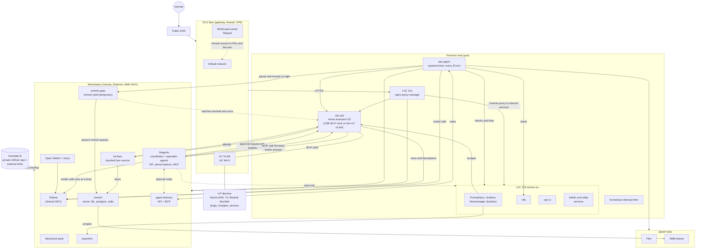

# homelab-ai-showcase

Working AI and automation projects from a self-hosted home lab. Everything runs
on local models (Ollama on one AMD Strix Halo GPU) and local services. Each folder
is code that runs in the lab today, with personal details replaced by
placeholders.

Four projects have their own repositories:

- [web-search-mcp](https://github.com/nishaero/web-search-mcp): an MCP server for
  live web search, weather, Home Assistant state and document search
- [agent-memory-mcp](https://github.com/nishaero/agent-memory-mcp): shared memory
  for several agents (Postgres with pgvector, HTTP API and MCP front end)
- [homelab-ops-agent](https://github.com/nishaero/homelab-ops-agent): the autonomous ops agent (sanitized,
  placeholders for hosts and addresses): allowlisted tools, backups with rollback, health checks, notification
  dedupe, 24 tests
- [homelab-multi-agent](https://github.com/nishaero/homelab-multi-agent): a coordinator
  and specialist agents that hand work to each other, with human approval, guard rails,
  an audit trail, 65 tests and a live evaluation

## Architecture

More detail: [architecture](docs/architecture.md), [AI design](docs/ai-design.md), [flows](docs/flows.md) and the [multi agent plan](docs/multi-agent-plan.md).

## What is in here

| Folder | What it shows |
|---|---|
| [docs](docs) | The architecture diagram, the AI design (tool list, guard rails, memory, failures and fixes), the run time flows and a plan for a multi agent workflow. The ops agent code is in [homelab-ops-agent](https://github.com/nishaero/homelab-ops-agent). |
| [doorbell-face-recognition](doorbell-face-recognition) | Face recognition against an existing photo library, a vision model for deliveries and vehicles, and a teach loop driven by phone notifications. |
| [gpu-sharing-gate](gpu-sharing-gate) | A reference counted pause and resume gate so background machine learning yields the GPU to latency sensitive work. |
| [nas-document-rag](nas-document-rag) | Text extraction, OCR with a vision model and ingestion into an Open WebUI knowledge base, all resumable and read only. |
| [local-llm-serving](local-llm-serving) | A vLLM on ROCm setup serving a quantized 32B model on an integrated GPU. |
| [voice-assistant](voice-assistant) | Local text to speech stack for a voice assistant, and a watchdog that recovers a hung Ollama. |
| [home-assistant-automations](home-assistant-automations) | Heating and hot water automations that use weather and solar forecasts, written for underfloor heating and a heat pump. |

## Skills these projects back up

| Skill | Where to look |
|---|---|
| MCP server development | web-search-mcp, agent-memory-mcp |
| Tool and function calling with local models | homelab-multi-agent, docs/ai-design.md, web-search-mcp |
| Multi agent orchestration and delegation | homelab-multi-agent |
| Agent guard rails and human approval | homelab-multi-agent, docs/ai-design.md |
| Evaluation and testing of agents | homelab-multi-agent (tests, routing evaluation, injection trial) |
| Agent memory and retrieval | agent-memory-mcp, nas-document-rag |
| Retrieval augmented generation | nas-document-rag, web-search-mcp (`search_documents`) |
| Vision language model integration | doorbell-face-recognition, nas-document-rag (OCR) |
| Face recognition pipeline | doorbell-face-recognition |
| Voice assistant infrastructure (text to speech bridge, Ollama watchdog) | voice-assistant |
| Local model hosting and GPU sharing | gpu-sharing-gate, local-llm-serving (vLLM, stopped now) |
| Failure analysis and debugging | the failure table in docs/ai-design.md |
| Home automation with forecasts | home-assistant-automations |

## Limits, stated plainly

- Test and evaluation sets are small. homelab-multi-agent has 65 tests and a 12 case routing
  evaluation. The ops agent has 24 tests of its guard rails, and the two MCP repositories have small test suites (8 and 6 tests). The doorbell,
  GPU gate, document search, voice and automation folders were checked on the live system only.
- The older ops agent stops an identical repeated tool call only. homelab-multi-agent adds
  detection of near identical calls and a cap per tool.
- The older agents (ops, doorbell, voice) are separate single purpose services. Agents that
  hand work to each other are in homelab-multi-agent, which runs beside them. The design
  notes are in [docs/multi-agent-plan.md](docs/multi-agent-plan.md).
- Prompt injection has been tried with one phrasing on the real models (flagged and ignored),
  not tested systematically.

## License

MIT
