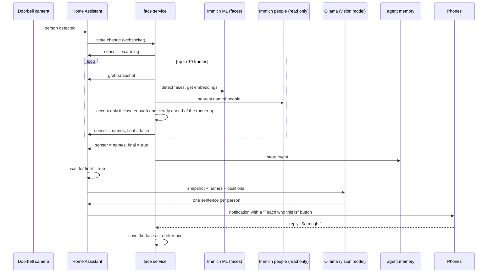
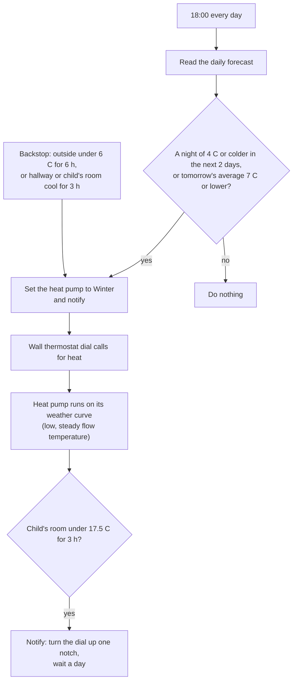
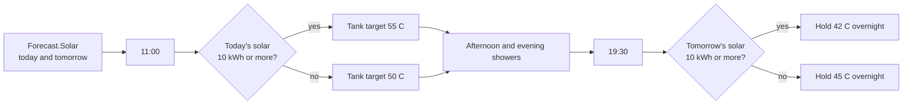
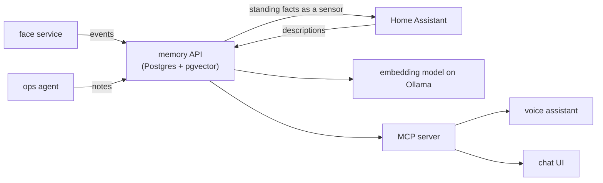
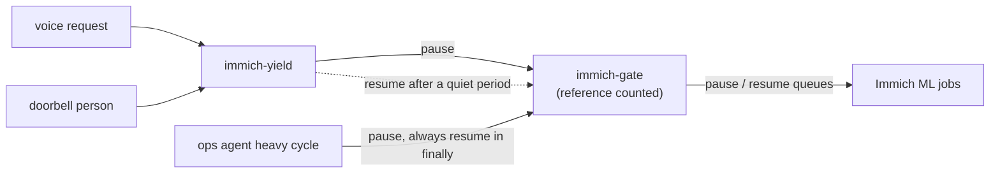

# Flows

How the main pieces work together at run time.

## Doorbell: who is at the door

## Heating: when to switch on

The heat pump has no room sensors. The wall dial is a plain contact, so Home
Assistant decides the season (Summer or Winter) and reports problems, and the
dial decides when heat is called.

## Hot water: when to heat the tank

The tank is heated in the warmest, sunniest hours, because the heat pump is
more efficient then and the electricity comes from the home's own solar panels
and battery.

## Memory: how agents share what they learn

Events are stored first and embedded afterwards, so a slow model never loses a
record. The MCP side can add facts but cannot delete anything.

## GPU sharing

A queue is only resumed when the last owner lets go. A queue that was paused on
purpose is never touched.
